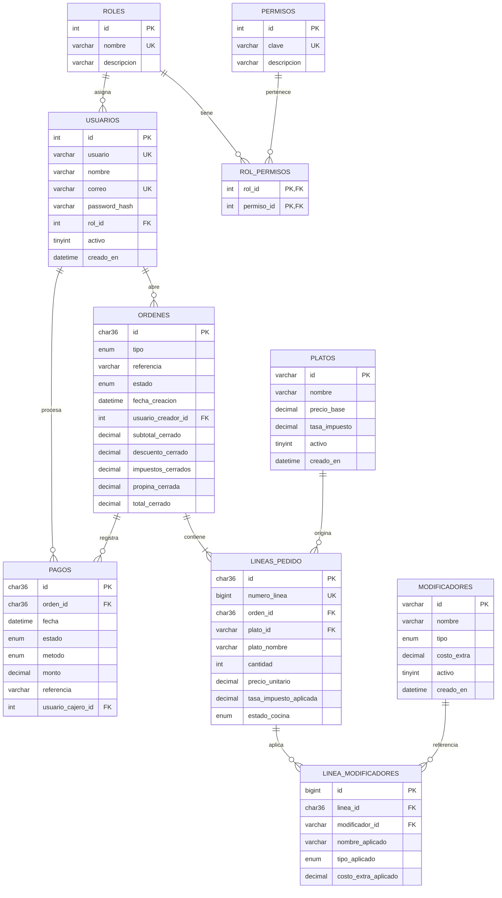

# Diseño de Base de Datos (`restaurante_pedidos`)

Base de datos relacional en **MySQL / MariaDB** (motor `InnoDB`, conjunto de caracteres `utf8mb4_unicode_ci`) diseñada en **Tercera Forma Normal (3FN)** para soportar autenticación, control de acceso por roles (RBAC), catálogo de menú, comandas, cocina y pagos.

---

## 1. Modelo Entidad–Relación (Mermaid)

---

## 2. Normalización (3FN) y Decisiones de Diseño

* **1FN:** Todas las columnas contienen valores atómicos; la relación N:M entre líneas y modificadores se descompone en `linea_modificadores`, y la relación N:M entre roles y permisos en `rol_permisos`.
* **2FN:** Todas las tablas con clave simple (`id`) o compuesta (`rol_permisos`) tienen todos sus atributos no clave funcionalmente dependientes de la clave completa.
* **3FN:** Los roles y permisos están separados en `roles` y `permisos` evitando dependencias transitivas en `usuarios`.
* **Inmutabilidad histórica (`RN-04`):** `lineas_pedido` copia `plato_nombre`, `precio_unitario` y `tasa_impuesto_aplicada`, y `linea_modificadores` copia `nombre_aplicado`, `tipo_aplicado` y `costo_extra_aplicado` en el instante de creación/edición de la línea. No es redundancia de catálogo sino **registro histórico del precio pactado** al momento de la compra, garantizando que cambios o bajas lógicas (`activo = 0`) en `platos` o `modificadores` no alteren órdenes existentes.
* **Totales congelados al cierre (`RN-12`):** `ordenes` almacena `subtotal_cerrado`, `descuento_cerrado`, `impuestos_cerrados`, `propina_cerrada` y `total_cerrado` únicamente cuando un pago es `APROBADO` y la orden cierra.

---

## 3. Diccionario de Datos

### Tabla `roles`
| Columna | Tipo | Nulo | Clave / Restricción | Descripción |
|---|---|---|---|---|
| `id` | `INT UNSIGNED` | No | `PK`, `AUTO_INCREMENT` | Identificador del rol |
| `nombre` | `VARCHAR(30)` | No | `UNIQUE` (`uq_roles_nombre`) | Nombre único (`ADMINISTRADOR`, `MESERO`, `COCINERO`, `CAJERO`) |
| `descripcion` | `VARCHAR(180)` | No | — | Descripción de responsabilidades |

### Tabla `permisos`
| Columna | Tipo | Nulo | Clave / Restricción | Descripción |
|---|---|---|---|---|
| `id` | `INT UNSIGNED` | No | `PK`, `AUTO_INCREMENT` | Identificador del permiso |
| `clave` | `VARCHAR(60)` | No | `UNIQUE` (`uq_permisos_clave`) | Clave técnica del permiso |
| `descripcion` | `VARCHAR(180)` | No | — | Descripción funcional |

### Tabla `rol_permisos`
| Columna | Tipo | Nulo | Clave / Restricción | Descripción |
|---|---|---|---|---|
| `rol_id` | `INT UNSIGNED` | No | `PK`, `FK → roles.id` | Rol asociado |
| `permiso_id` | `INT UNSIGNED` | No | `PK`, `FK → permisos.id` | Permiso asociado |

### Tabla `usuarios`
| Columna | Tipo | Nulo | Clave / Restricción | Descripción |
|---|---|---|---|---|
| `id` | `INT UNSIGNED` | No | `PK`, `AUTO_INCREMENT` | Identificador del usuario |
| `usuario` | `VARCHAR(30)` | No | `UNIQUE` (`uq_usuarios_usuario`) | Nombre de usuario para login |
| `nombre` | `VARCHAR(100)` | No | — | Nombre completo |
| `correo` | `VARCHAR(120)` | No | `UNIQUE` (`uq_usuarios_correo`) | Correo electrónico |
| `password_hash` | `VARCHAR(255)` | No | — | Hash bcrypt/argon2 generado por `password_hash()` |
| `rol_id` | `INT UNSIGNED` | No | `FK → roles.id`, `INDEX` | Rol asignado |
| `activo` | `TINYINT(1)` | No | `DEFAULT 1`, `INDEX` | `1` activo, `0` bloqueado |
| `creado_en` | `DATETIME` | No | `DEFAULT CURRENT_TIMESTAMP` | Fecha de alta |

### Tabla `platos`
| Columna | Tipo | Nulo | Clave / Restricción | Descripción |
|---|---|---|---|---|
| `id` | `VARCHAR(32)` | No | `PK` | Código de catálogo (ej. `P-001`) |
| `nombre` | `VARCHAR(120)` | No | `INDEX (activo, nombre)` | Nombre del platillo |
| `precio_base` | `DECIMAL(10,2)` | No | `CHECK (precio_base > 0)` | Precio unitario sin impuesto |
| `tasa_impuesto` | `DECIMAL(5,4)` | No | `CHECK (0 <= tasa <= 1)` | Fracción de impuesto (ej. `0.1600`) |
| `activo` | `TINYINT(1)` | No | `DEFAULT 1` | `1` vigente, `0` eliminado lógicamente |
| `creado_en` | `DATETIME` | No | `DEFAULT CURRENT_TIMESTAMP` | Fecha de registro |

### Tabla `modificadores`
| Columna | Tipo | Nulo | Clave / Restricción | Descripción |
|---|---|---|---|---|
| `id` | `VARCHAR(32)` | No | `PK` | Código de modificador (ej. `M-001`) |
| `nombre` | `VARCHAR(120)` | No | `INDEX (activo, nombre)` | Nombre (ej. *Queso extra*, *Sin cebolla*) |
| `tipo` | `ENUM('EXTRA','EXCLUSION')` | No | — | Naturaleza del modificador |
| `costo_extra` | `DECIMAL(10,2)` | No | `CHECK (>=0)`, `EXCLUSION => 0` | Costo adicional |
| `activo` | `TINYINT(1)` | No | `DEFAULT 1` | `1` vigente, `0` eliminado lógicamente |
| `creado_en` | `DATETIME` | No | `DEFAULT CURRENT_TIMESTAMP` | Fecha de registro |

### Tabla `ordenes`
| Columna | Tipo | Nulo | Clave / Restricción | Descripción |
|---|---|---|---|---|
| `id` | `CHAR(36)` | No | `PK` | UUID de la orden |
| `tipo` | `ENUM('SALA','PARA_LLEVAR','DELIVERY')` | No | — | Canal del pedido |
| `referencia` | `VARCHAR(80)` | No | — | Mesa o identificador externo |
| `estado` | `ENUM('ABIERTA','CERRADA','CANCELADA')` | No | `INDEX (estado, fecha_creacion)` | Estado general de la comanda |
| `fecha_creacion` | `DATETIME` | No | `DEFAULT CURRENT_TIMESTAMP` | Fecha/hora de apertura |
| `usuario_creador_id` | `INT UNSIGNED` | Sí | `FK → usuarios.id` | Mesero que abrió la orden |
| `subtotal_cerrado` | `DECIMAL(10,2)` | Sí | — | Subtotal congelado al cerrar |
| `descuento_cerrado` | `DECIMAL(10,2)` | Sí | — | Descuento aplicado al cerrar |
| `impuestos_cerrados` | `DECIMAL(10,2)` | Sí | — | Impuestos cobrados al cerrar |
| `propina_cerrada` | `DECIMAL(10,2)` | Sí | — | Propina cobrada al cerrar |
| `total_cerrado` | `DECIMAL(10,2)` | Sí | — | Total final cobrado al cerrar |

### Tabla `lineas_pedido`
| Columna | Tipo | Nulo | Clave / Restricción | Descripción |
|---|---|---|---|---|
| `id` | `CHAR(36)` | No | `PK` | UUID de la línea |
| `numero_linea` | `BIGINT UNSIGNED` | No | `UNIQUE`, `AUTO_INCREMENT` | Orden secuencial de inserción |
| `orden_id` | `CHAR(36)` | No | `FK → ordenes.id`, `INDEX` | Orden propietaria |
| `plato_id` | `VARCHAR(32)` | No | `FK → platos.id`, `INDEX` | Plato del catálogo |
| `plato_nombre` | `VARCHAR(120)` | No | — | Nombre histórico al crear la línea |
| `cantidad` | `INT UNSIGNED` | No | `CHECK (cantidad > 0)` | Cantidad pedida |
| `precio_unitario` | `DECIMAL(10,2)` | No | — | Precio unitario congelado |
| `tasa_impuesto_aplicada` | `DECIMAL(5,4)` | No | — | Tasa de impuesto congelada |
| `estado_cocina` | `ENUM('PENDIENTE','EN_COCCION','LISTO','CANCELADA')` | No | `INDEX` | Estado de preparación |

### Tabla `linea_modificadores`
| Columna | Tipo | Nulo | Clave / Restricción | Descripción |
|---|---|---|---|---|
| `id` | `BIGINT UNSIGNED` | No | `PK`, `AUTO_INCREMENT` | Identificador interno |
| `linea_id` | `CHAR(36)` | No | `FK → lineas_pedido.id`, `INDEX` | Línea a la que aplica |
| `modificador_id` | `VARCHAR(32)` | No | `FK → modificadores.id`, `INDEX` | Modificador del catálogo |
| `nombre_aplicado` | `VARCHAR(120)` | No | — | Nombre congelado |
| `tipo_aplicado` | `ENUM('EXTRA','EXCLUSION')` | No | — | Tipo congelado |
| `costo_extra_aplicado` | `DECIMAL(10,2)` | No | — | Costo extra congelado |

### Tabla `pagos`
| Columna | Tipo | Nulo | Clave / Restricción | Descripción |
|---|---|---|---|---|
| `id` | `CHAR(36)` | No | `PK` | UUID del intento de pago |
| `orden_id` | `CHAR(36)` | No | `FK → ordenes.id`, `INDEX` | Orden cobrada |
| `fecha` | `DATETIME` | No | `DEFAULT CURRENT_TIMESTAMP` | Fecha/hora del intento |
| `estado` | `ENUM('PENDIENTE','APROBADO','RECHAZADO')` | No | `INDEX (orden_id, estado)` | Resultado del intento |
| `metodo` | `ENUM('EFECTIVO','TARJETA','PASARELA_DIGITAL')` | No | — | Método utilizado |
| `monto` | `DECIMAL(10,2)` | No | `CHECK (monto >= 0)` | Monto procesado |
| `referencia` | `VARCHAR(64)` | Sí | — | Folio (`EFE-`, `TAR-`, `PAS-`) |
| `usuario_cajero_id` | `INT UNSIGNED` | Sí | `FK → usuarios.id` | Cajero que procesó el cobro |
