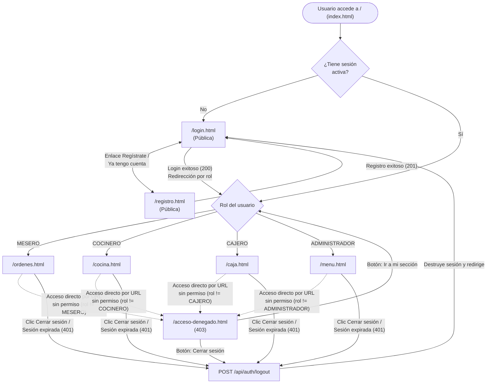

# Diagrama de Navegación

Este diagrama describe los flujos de navegación entre pantallas públicas, protegidas y de error, contemplando autenticación, redirección por rol, cierre de sesión, sesión expirada (`401`) y falta de permisos (`403`).

---

## Reglas de Redirección

1. **Usuario anónimo intentando abrir una página protegida** (`/ordenes.html`, `/cocina.html`, `/caja.html`, `/menu.html`, `/acceso-denegado.html`):
   * El guardia de cliente (`js/auth/sesion.js`) consulta `GET /api/auth/me`. Al recibir `401 Unauthorized`, redirige inmediatamente a `/login.html`.
   * Cualquier llamada directa a la API protegida sin cookie de sesión devuelve `401 Unauthorized`.
2. **Usuario autenticado abriendo `/login.html` o `/registro.html`:**
   * Se consulta `GET /api/auth/me`. Si ya hay sesión válida, se redirige a la página principal de su rol.
3. **Usuario autenticado abriendo una página de otro rol:**
   * El guardia de página verifica `usuario.rol`. Si no está autorizado para esa página, redirige a `/acceso-denegado.html`.
   * En el servidor, cada endpoint verifica el rol en `$_SESSION` y responde `403 Forbidden` si un cliente intenta invocar una acción de otro rol.
4. **Expiración de sesión durante el uso o polling (Cocina/Caja):**
   * Si `http.js` recibe HTTP `401` en cualquier petición, limpia el estado local y redirige a `/login.html`.
5. **Cierre de sesión (Logout):**
   * Al pulsar **Cerrar sesión**, se invoca `POST /api/auth/logout`, PHP destruye `$_SESSION` y expira la cookie, y el navegador redirige a `/login.html`.
