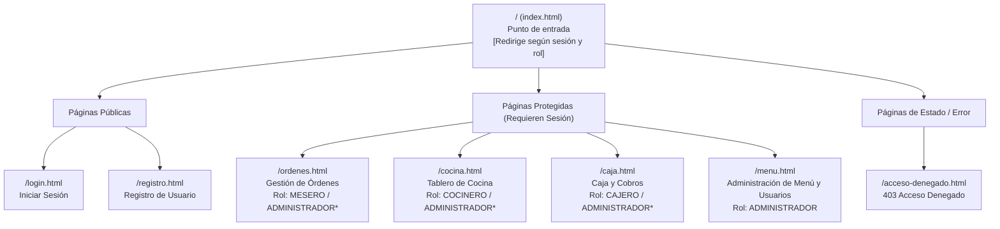

# Mapa de Sitio

> **Supuesto S-02:** El sistema evoluciona de una SPA en un único `index.html` con rutas `#/...` a una estructura web multipágina semántica dentro de `/public`, con páginas diferenciadas para acceso público, redirección inicial, cada módulo operativo por rol y pantalla de acceso denegado.

---

## 1. Jerarquía del Sitio

*\*Nota de supuesto: Se propone que `ADMINISTRADOR` pueda supervisar todos los módulos o restringirlo exclusivamente a `/menu.html` (ver tabla de permisos abajo; por defecto en Fase 3 aplicaremos el principio estricto por rol salvo que indiques que `ADMINISTRADOR` supervise todo).*

---

## 2. Inventario de Páginas y Matriz de Acceso

| Ruta / Página | Tipo de acceso | Roles permitidos | Propósito | Comportamiento sin sesión | Comportamiento sin permiso (rol distinto) |
|---|---|---|---|---|---|
| `/index.html` (`/`) | Enrutador de entrada | Cualquiera | Verificar si existe sesión activa y redirigir a la pantalla correspondiente. | Redirige a `/login.html`. | Redirige a la vista principal del rol del usuario. |
| `/login.html` | **Pública** (solo invitados) | Sin sesión | Autenticar usuario con correo/usuario y contraseña. | Muestra formulario de login. | Si ya tiene sesión activa, redirige a su módulo inicial. |
| `/registro.html` | **Pública** (solo invitados) | Sin sesión | Registrar una cuenta nueva (**Supuesto S-01:** rol inicial `MESERO`). | Muestra formulario de registro. | Si ya tiene sesión activa, redirige a su módulo inicial. |
| `/ordenes.html` | **Protegida** (Sesión requerida) | `MESERO` *(y `ADMINISTRADOR` si se habilita supervisión)* | Abrir órdenes, agregar/editar/cancelar líneas, cancelar orden y ver totales/pagos. | Redirige a `/login.html`. | Redirige a `/acceso-denegado.html` (403). |
| `/cocina.html` | **Protegida** (Sesión requerida) | `COCINERO` *(y `ADMINISTRADOR` si se habilita supervisión)* | Visualizar tablero de 3 columnas (*En fila*, *En cocción*, *Listo para entrega*) y avanzar estados. | Redirige a `/login.html`. | Redirige a `/acceso-denegado.html` (403). |
| `/caja.html` | **Protegida** (Sesión requerida) | `CAJERO` *(y `ADMINISTRADOR` si se habilita supervisión)* | Calcular totales con descuento/propina, cobrar órdenes listas y ver historial de pagos. | Redirige a `/login.html`. | Redirige a `/acceso-denegado.html` (403). |
| `/menu.html` | **Protegida** (Sesión requerida) | `ADMINISTRADOR` | CRUD de platos, CRUD de modificadores y gestión de roles de usuarios. | Redirige a `/login.html`. | Redirige a `/acceso-denegado.html` (403). |
| `/acceso-denegado.html` | **Protegida** (Estado 403) | Cualquier usuario autenticado | Informar falta de permisos y ofrecer botón de regreso a su vista autorizada o cerrar sesión. | Redirige a `/login.html`. | Muestra mensaje 403 y enlace a su ruta permitida. |

---

## 3. Barra de Navegación Dinámica por Rol

En el `<header>` de las páginas protegidas, el `<nav>` mostrará **únicamente** los enlaces permitidos para el rol en sesión, junto con el nombre del usuario, su rol y el botón **Cerrar sesión**:

| Rol | Ruta inicial por defecto tras login | Enlaces visibles en `<nav>` |
|---|---|---|
| `MESERO` | `/ordenes.html` | Órdenes |
| `COCINERO` | `/cocina.html` | Cocina |
| `CAJERO` | `/caja.html` | Caja |
| `ADMINISTRADOR` | `/menu.html` | Menú *(y Usuarios)* — **[Supuesto S-06: Definir si Administrador ve solo Menú/Usuarios o también Órdenes, Cocina y Caja en modo supervisión]** |

---

## 4. Endpoints Backend (`/php/api/...`) y Protección

| Grupo de rutas | Visibilidad / Roles autorizados en servidor |
|---|---|
| `POST /api/auth/login`, `POST /api/auth/register` | Públicos (sin sesión previa) |
| `POST /api/auth/logout`, `GET /api/auth/me` | Cualquier usuario autenticado (`logout` también idempotente) |
| `GET /api/platos`, `GET /api/modificadores` | `ADMINISTRADOR`, `MESERO` (para armar líneas) |
| `POST/PUT/DELETE /api/platos*`, `POST/PUT/DELETE /api/modificadores*` | Exclusivo `ADMINISTRADOR` |
| `GET/POST/PUT/DELETE /api/usuarios*` | Exclusivo `ADMINISTRADOR` |
| `GET /api/ordenes*`, `POST /api/ordenes*`, `PUT/DELETE /api/ordenes/*/lineas*` | `MESERO` (y `GET /api/ordenes*` para `CAJERO` solo consulta de órdenes listas) |
| `GET /api/cocina/pendientes`, `POST /api/cocina/ordenes/*/lineas/*/(iniciar\|lista)` | Exclusivo `COCINERO` |
| `GET /api/caja/ordenes/*/totales`, `POST /api/caja/ordenes/*/cobrar` | Exclusivo `CAJERO` |
